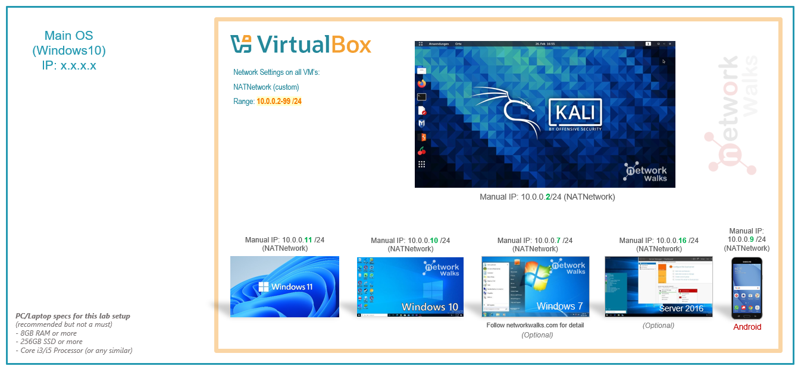
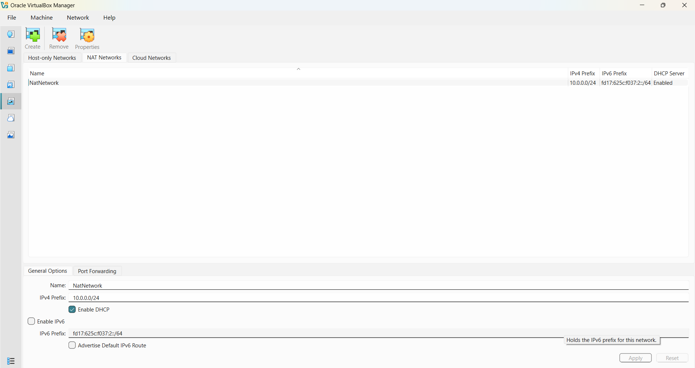
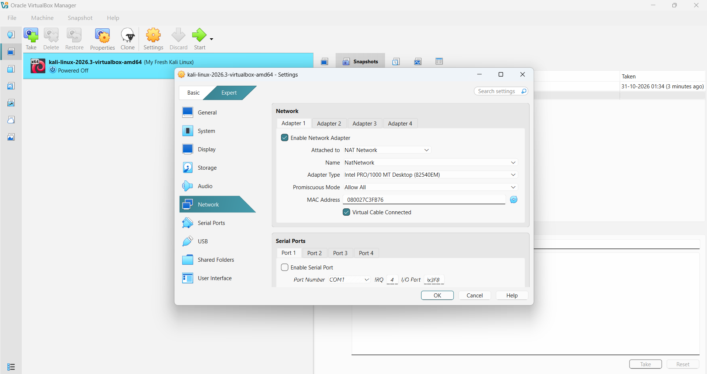
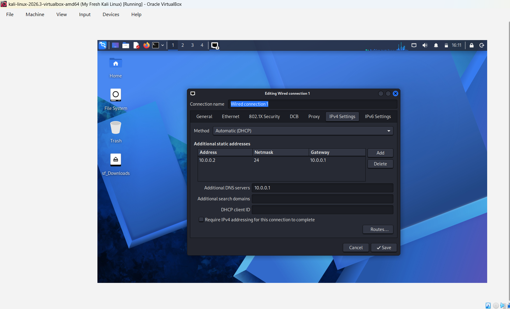

# 🔐 Cybersecurity Lab Environment Setup

**Building a Secure & Isolated Virtual Penetration Testing Laboratory**

  
  
  
  

---

## 📌 Project Overview

This project focuses on the end-to-end design, deployment, and configuration of an **isolated virtual cybersecurity and penetration testing lab** using Oracle VM VirtualBox and Kali Linux. 

In cybersecurity and defensive/offensive security operations, having a sandbox environment is essential. It enables practitioners to conduct network reconnaissance, vulnerability assessments, penetration tests, and traffic analysis in a controlled setting without risking production networks or violating legal boundaries.

The laboratory is configured on a segmented **NAT Network (10.0.0.0/24)**, ensuring internal VM-to-VM communication for future multi-host testing while maintaining controlled Internet routing through the host system.

---

## 🎯 Objectives

The key goals accomplished in this project:

- Deploy and tune the **Oracle VM VirtualBox** hypervisor on Windows.
- Import and configure the **Kali Linux** virtual appliance.
- Create and manage a customized **VirtualBox NAT Network** (NatNetwork - 10.0.0.0/24).
- Implement static IPv4 addressing, default gateway routing, and DNS configuration on Kali Linux.
- Execute network verification tests to validate gateway ping, Internet reachability, and DNS resolution.
- Establish an immutable baseline snapshot for fast state rollback and recovery.
- Document troubleshooting workflows and lessons learned for security engineering practice.

---

## 🛡️ Purpose & Scope of the Laboratory

The virtual laboratory provides an ethical testing sandbox tailored for:

- **Network Discovery & Reconnaissance:** Network mapping and port scanning with Nmap.
- **Traffic & Protocol Analysis:** Packet dissection and security auditing using Wireshark.
- **Vulnerability Assessment:** Scanning and service enumeration against target virtual machines.
- **Web Application Security:** Testing OWASP Top 10 vulnerabilities in an isolated setting.
- **Exploitation & Post-Exploitation Practice:** Controlled exploitation simulations within an authorized boundary.

> ⚠️ **Legal & Ethical Notice:** This laboratory is strictly intended for educational, academic, and defensive security research. All activities are confined to isolated virtual instances owned by the user. Unauthorized access to external networks or systems is strictly illegal.

---

## 🏗️ Lab Architecture

The topology below illustrates the lab design. The host operating system isolates the virtual machines inside a dedicated private NAT Network (10.0.0.0/24), enabling future multi-target environments (Windows 10, Windows Server, Android):

*Figure 1: Lab Architecture and IP Addressing Scheme.*

---

## ⚙️ Lab Configuration & Specifications

The virtual machine and hypervisor parameters are summarized below:

| 🧩 Parameter | ⚙️ Configuration Value |
| :--- | :--- |
| 🖥️ **Host Operating System** | Windows 10 / 11 (64-bit) |
| 🧠 **Host System Memory** | 8 GB / 16 GB DDR4 |
| ⚡ **Processor Architecture** | Multi-Core x86_64 (VT-x / AMD-V Enabled) |
| 🧰 **Hypervisor Platform** | Oracle VM VirtualBox v7.x |
| 🐉 **Security Testing OS** | Kali Linux 2026.x (64-bit Release) |
| 🧠 **Allocated Virtual RAM** | 2048 MB (2 GB) |
| ⚡ **Allocated vCPUs** | 2 vCPUs |
| 🌐 **Virtual Network Adapter** | NAT Network (NatNetwork) |
| 📡 **Network Subnet & Mask** | 10.0.0.0/24 (255.255.255.0) |
| 🐧 **Kali Assigned IPv4** | 10.0.0.2 / 24 |
| 🚪 **Default Gateway** | 10.0.0.1 |
| 🌍 **Primary DNS Server** | 8.8.8.8 (Google Public DNS) |
| 🔮 **Future Target Subnet Range** | 10.0.0.3 – 10.0.0.99 |

---

# 🪜 Step-by-Step Lab Setup Procedure

### Step 1: Install 7-Zip Utility
To safely extract the compressed Kali Linux pre-configured virtual appliance (.7z), 7-Zip was installed on the host operating system.

### Step 2: Install and Prepare VirtualBox
The Oracle VM VirtualBox hypervisor was installed alongside the VirtualBox Extension Pack, enabling enhanced device emulation, virtual storage controller acceleration, and bidirectional clipboard integration.

### Step 3: Configure the Dedicated NAT Network
Under **VirtualBox Tools > Network Manager**, a custom NAT Network was provisioned:
- **Network Name:** NatNetwork
- **IPv4 Prefix:** 10.0.0.0/24
- **DHCP Service:** Enabled
- **IPv6:** Disabled

*Figure 2: VirtualBox NAT Network Configuration (10.0.0.0/24).*

> **Technical Context:** Unlike a standard NAT adapter (which places each VM behind an isolated private router), a **NAT Network** acts as a virtual switch. Multiple machines attached to the same NAT Network can route packets directly to each other while sharing outbound Internet access.

---

### Step 4: Import and Provision the Kali Linux VM
1. The official pre-built Kali Linux VirtualBox image was imported.
2. The network interface was modified under **Settings > Network > Adapter 1**:
   - **Attached to:** NAT Network
   - **Name:** NatNetwork
   - **Adapter Type:** Intel PRO/1000 MT Desktop
   - **Promiscuous Mode:** Allow All
3. Assigned 2048 MB of RAM and 2 virtual processor cores.
4. Configured a VirtualBox Shared Folder (`sf_Downloads`) to seamlessly transfer project files between the Windows host operating system and the Kali VM.

*Figure 3: Kali Linux Desktop Environment Loaded in VirtualBox.*

---

### Step 5: Configure Persistent IPv4 Settings in Kali Linux
To maintain predictable communication and simplify penetration testing scripts, static network parameters were configured via NetworkManager (Wired connection 1):

- **IPv4 Method:** Manual
- **Address:** 10.0.0.2
- **Netmask:** 24 (255.255.255.0)
- **Gateway:** 10.0.0.1
- **DNS Server:** 8.8.8.8

*Figure 4: Kali Linux Static IPv4 Network Configuration.*

---

### Step 6: Create a Clean Baseline Snapshot
Following initial setup and verification, a clean VirtualBox snapshot was captured:
- **Snapshot Label:** Clean Kali - Baseline Network Setup
- **Description:** Clean operating system state with static IP and tools validated.

Creating snapshots before launching simulated attacks or tool tests provides a rapid recovery mechanism against configuration drift or system corruption.

---

# 🔎 Lab Verification & Connectivity Tests

To ensure network integrity and operational readiness, the following diagnostic tests were performed:

| ✅ Test Description | 🧾 Verification Command | 🎯 Observed Result | Status |
| :--- | :--- | :--- | :---: |
| **Verify Local IP Binding** | ip a show eth0 | inet 10.0.0.2/24 brd 10.0.0.255 scope global | **PASS** |
| **Test Gateway Connectivity** | ping -c 4 10.0.0.1 | 4 packets transmitted, 4 received, 0% loss, avg 0.38ms | **PASS** |
| **Test Public Internet Access** | ping -c 4 8.8.8.8 | 4 packets transmitted, 4 received, 0% loss | **PASS** |
| **Validate DNS Resolution** | 
slookup networkwalks.com | Resolves canonical domain name to authoritative IPv4 address | **PASS** |
| **Verify Security Tooling** | 
map --version | Nmap version confirmed and executable | **PASS** |
| **Validate Snapshot Restore** | Revert snapshot & re-run ip a | Environment restored cleanly to 10.0.0.2/24 baseline | **PASS** |

### Verified Output Parameters:
`	ext
Host IP Address:      10.0.0.2/24
Default Gateway:      10.0.0.1
Primary Nameserver:   8.8.8.8
Virtual Network Name: NatNetwork
`

---

# 🐞 Encountered Issues & Troubleshooting Solutions

### Issue 1: Gateway Drop & DNS Timeout Following Static IP Assignment
* **Symptoms:** After transitioning from DHCP to static IP 10.0.0.2, outbound pings to external DNS (8.8.8.8) timed out while local gateway ping succeeded.
* **Root Cause:** NetworkManager Duplicate Address Detection (DAD) delay prevented immediate route initialization on the virtual Ethernet interface.
* **Troubleshooting Steps:**
  1. Modified connection parameters to disable DAD timeout:
     `ash
     sudo nmcli connection modify Wired connection 1 ipv4.dad-timeout 0
     `
  2. Cycled the connection interface:
     `ash
     sudo nmcli connection down Wired connection 1 && sudo nmcli connection up Wired connection 1
     `
  3. Re-verified default route table:
     `ash
     ip route show
     # Confirmed: default via 10.0.0.1 dev eth0 proto static metric 100
     `

### Issue 2: VirtualBox Hardware Virtualization Error (VT-x / AMD-V)
* **Symptoms:** VirtualBox failed to boot the Kali VM, reporting that hardware-assisted virtualization was disabled on the host CPU.
* **Root Cause:** Intel Virtualization Technology (Intel VT-x) was disabled in the motherboard BIOS/UEFI settings.
* **Troubleshooting Steps:**
  1. Restarted the host PC and pressed F2/Del to enter BIOS setup.
  2. Located **CPU Configuration** > enabled **Intel Virtualization Technology**.
  3. Saved BIOS configuration (F10) and booted into Windows.
  4. Kali VM launched without further hypervisor conflicts.

---

# 💡 Key Learnings & Engineering Takeaways

1. **NAT vs. NAT Network Differentiation:** Mastered the architectural difference between isolated NAT (per-VM isolation) and NAT Network (switched virtual segment), which is vital for multi-machine penetration testing topologies.
2. **Deterministic Network Engineering:** Learned how static IP allocation prevents IP churn, ensuring reconnaissance scripts, scanners, and reverse shells remain reliable across reboots.
3. **Resilience Through Snapshots:** Understood the operational necessity of creating clean baseline snapshots prior to executing intrusive pentesting scripts or modifying kernel modules.
4. **Professional Technical Documentation:** Recognized that documenting exact commands, subnet parameters, visual evidence, and troubleshooting logs is fundamental to professional security reporting.

---

# 🔐 Ethical Use & Safety Compliance

This penetration testing environment was built strictly in accordance with ethical hacking standards. Testing is performed exclusively within isolated, self-hosted virtual machines. No unauthorized networks, systems, or third-party devices were targeted.

---

# 🔗 Resources & References

- **Oracle VM VirtualBox:** [https://www.virtualbox.org/](https://www.virtualbox.org/)
- **Kali Linux Documentation:** [https://www.kali.org/docs/](https://www.kali.org/docs/)
- **7-Zip Compression Utility:** [https://www.7-zip.org/](https://www.7-zip.org/)
- **Network Walks Academy:** [https://networkwalks.com/](https://networkwalks.com/)

---

# 👤 Author & Acknowledgements

**Manoj Santosh Tandle**  
*Cybersecurity Intern — Batch B084*  
*Specialization: Cybersecurity, Penetration Testing & SOC Operations*  
*GitHub Profile:* [ManojTandle28](https://github.com/ManojTandle28)

Special appreciation to our instructor **Waqas Karim CCIE** and the **Network Walks** team for structured mentorship and hands-on guidance.

---

## 📌 Project Metadata
* **Program:** Network Walks Cybersecurity Internship
* **Cohort:** Batch B084
* **Module:** Week 01 — Project PM1
* **Project Name:** Cybersecurity & Pentesting Lab Setup
* **Repository Type:** Public Technical Documentation
